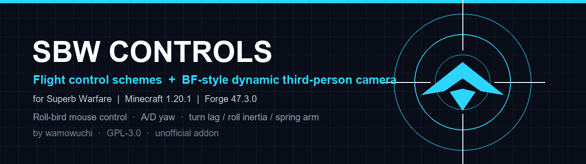

# SBW Controls



**Flight control schemes & BF-style dynamic third-person camera for Superb Warfare.**

- Minecraft 1.20.1 / Forge 47.3.0 / Java 17
- Dependencies: Superb Warfare 0.8.9.2 + Kotlin for Forge 4.12.0
- License: GPL-3.0
- Author: sakasiyhaha
- GitHub: https://github.com/sakasiyhaha/sbw-controls

> Unofficial addon for Superb Warfare. Not affiliated with the Superb Warfare team.

---

## AI-assisted development

This is an AI-assisted project, not a fully automated one.

- Development was done through AI pair programming (DeepSeek Harness): a substantial portion of the Java implementation, refactoring, documentation and test scaffolding was generated with AI.
- The human author defined the feature requirements and design direction, repeatedly tested the addon in-game, tuned the camera and control values, reviewed changes, and manages releases.
- AI was used as a development tool; a human remains responsible for the project and its behavior.

---

## Features

- **Roll-bird control scheme**: mouse X roll, A/D yaw, mouse Y pitch.
- Yaw-bird / roll-bird / hybrid / fully custom schemes.
- **BF-style dynamic third-person camera**: turn lag, roll inertia, spring-arm position lag, adaptive damping, speed FOV, dynamic distance and lateral centering.
- **Camera spring v2**: fixed 120 Hz substep spring, damping ratio (`spring_damping`), angular-rate smoothing (`rate_smoothing`) and soft turn-lag limits (`soft_limit`).
- **Separate first-person / ADS zoom camera settings**, stock by default.
- In-game config screen, TOML, 9 native key bindings, client/server commands.
- **Graceful multiplayer fallback**: clients can join servers without the addon; scheme switching is disabled, camera and client settings still work.
- Only fixed-wing and helicopter vehicles are taken over. Tanks, cars, boats, etc. remain stock.

---

## Documentation

- [1.1.0 release notes](docs/RELEASE-NOTES-1.1.0.md)
- [中文完整使用说明](docs/USAGE.zh-CN.md)
- [English user guide](docs/USAGE.en.md)
- [Promotion kit](docs/PROMOTION.md)

---

## Installation (players)

1. Install Minecraft 1.20.1 + Forge 47.3.0 + Java 17.
2. Put into `mods/`:
   - `sbwcontrol-1.1.0.jar` (from Releases)
   - `superbwarfare-0.8.9.2-all.jar`
   - `kotlinforforge-4.12.0-all.jar`
3. Launch.

GeckoLib, Cloth Config, Curios, Flywheel, Ponder, SimpleBedrockModel and Rhino are embedded in the Superb Warfare `-all` jar through JarJar.

---

## Build from source

This repository does **not** include third-party jars.

1. Install JDK 17.
2. Put these files into `libs/`:
   - `superbwarfare-0.8.9.2-all.jar`
   - `kotlinforforge-4.12.0-all.jar`
   They can be copied from the modpack `mods/` folder or downloaded from their official pages.
3. Run:

```bash
./gradlew build
```

Windows:

```bat
gradlew.bat build
```

Output: `build/libs/sbwcontrol-1.1.0.jar`.

---

## Links

- GitHub: https://github.com/sakasiyhaha/sbw-controls
- Issues: https://github.com/sakasiyhaha/sbw-controls/issues
- Modrinth: https://modrinth.com/mod/sbw-controls
- Source and licenses: see `LICENSE` and `docs/`

---

## Credits

- Addon: **sakasiyhaha**
- Superb Warfare: **Atsuishio, Roki27, Light_Quanta and contributors** (GPL-3.0)
- Kotlin for Forge: **thedarkcolour** (LGPL-2.1)

## License

SBW Controls is licensed under **GPL-3.0**. See [LICENSE](LICENSE).

> Unofficial addon; not affiliated with the Superb Warfare team.
