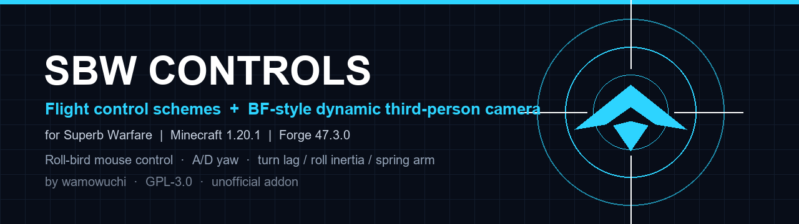

# SBW Controls



**Flight control schemes & camera / aiming fixes for Superb Warfare.**

- Minecraft 1.20.1 / Forge 47.3.0 / Java 17
- Dependencies: Superb Warfare 0.8.9.2 + Kotlin for Forge 4.12.0
- License: GPL-3.0
- Author: sakasiyhaha
- GitHub: https://github.com/sakasiyhaha/sbw-controls

> Unofficial addon for Superb Warfare. Not affiliated with the Superb Warfare team.

---

## AI-assisted development

This is an AI-assisted project, not a fully automated one.

- Development was done through AI pair programming (DeepSeek Harness): a substantial portion of the Java implementation, refactoring, documentation and test scaffolding was generated with AI.
- The human author defined the feature requirements and design direction, repeatedly tested the addon in-game, tuned the camera and control values, reviewed changes, and manages releases.
- AI was used as a development tool; a human remains responsible for the project and its behavior.

---

## Features

### Controls

- **Roll-bird control scheme**: mouse X roll, A/D yaw, mouse Y pitch.
- Yaw-bird / roll-bird / hybrid / fully custom schemes.
- 9 native key bindings and in-game config screen.
- Graceful multiplayer fallback when the server does not have the addon.

### Camera

- **BF-style third-person camera**: turn lag, roll inertia, spring-arm position lag, adaptive damping, speed FOV, dynamic distance and lateral centering.
- **Camera spring v2**: fixed 120 Hz substep spring, damping ratio, angular-rate smoothing and soft turn-lag limits.
- **Fixed-wing independent camera**: ignores the stock Superb Warfare seat camera position, targets the aircraft bounding-box center, uses absolute distance/height and its own collision smoothing.
- **Follow / dynamic modes**:
  - Follow: camera rotates with the aircraft, including full 180°+ rolls.
  - Dynamic: horizon-stable; the aircraft visibly rolls.
- Separate first-person / ADS zoom settings; stock by default.
- Fixed 180° roll handling: shortest-angle interpolation and continuous camera roll values.

### Aiming / weapons (1.2.0)

- **RollBird center aim** is active in first person, follow and dynamic third-person camera modes.
- **Helicopter A/D yaw** uses the native `mouseMoveSpeedX` channel with the previous rate formula preserved:
  `mouseX = yaw * max_yaw_rate / (40 * syncedPropellerRot)`.
- **Mouse roll** is converted to elastic native A/D key presses via 6-tick pulse-width modulation.
- **Turret yaw compensation** keeps the turret at the client-frame aim direction.
- **`getShootVec` Mixin** overrides the actual server-side shot direction for both fixed guns and turrets, so cannon shells/rockets leave along the client-frame aircraft/launcher direction instead of a delayed server heading.
- This fixes the A/D turning case where bullets/rockets appeared to drift toward the rotation tangent.

### Compatibility

- Only fixed-wing and helicopter vehicles are taken over. Tanks, cars, boats, etc. remain stock.
- Client and server must use the same `sbwcontrol` protocol version.

---

## Documentation

- [1.2.0 release notes](docs/RELEASE-NOTES-1.2.0.md)
- [完整更新日志](CHANGELOG.md)
- [中文完整使用说明](docs/USAGE.zh-CN.md)
- [English user guide](docs/USAGE.en.md)
- [Promotion kit](docs/PROMOTION.md)

---

## Installation (players)

1. Install Minecraft 1.20.1 + Forge 47.3.0 + Java 17.
2. Put into `mods/`:
   - `sbwcontrol-1.2.0.jar` (from Releases)
   - `superbwarfare-0.8.9.2-all.jar`
   - `kotlinforforge-4.12.0-all.jar`
3. Launch.

GeckoLib, Cloth Config, Curios, Flywheel, Ponder, SimpleBedrockModel and Rhino are embedded in the Superb Warfare `-all` jar through JarJar.

**Important:** this version requires both client and server to run `sbwcontrol` 1.2.0. The control packet protocol was bumped to version 3.

---

## Build from source

This repository does **not** include third-party jars.

1. Install JDK 17.
2. Put these files into `libs/`:
   - `superbwarfare-0.8.9.2-all.jar`
   - `kotlinforforge-4.12.0-all.jar`
3. Run:

```bash
./gradlew build
```

Windows:

```bat
gradlew.bat build
```

Output: `build/libs/sbwcontrol-1.2.0.jar`.

A headless GameTest suite is available:

```bash
./gradlew runGameTestServer
```

---

## Links

- GitHub: https://github.com/sakasiyhaha/sbw-controls
- Issues: https://github.com/sakasiyhaha/sbw-controls/issues
- Modrinth: https://modrinth.com/mod/sbw-controls
- Source and licenses: see `LICENSE` and `docs/`

---

## Credits

- Addon: **sakasiyhaha**
- Superb Warfare: **Atsuishio, Roki27, Light_Quanta and contributors** (GPL-3.0)
- Kotlin for Forge: **thedarkcolour** (LGPL-2.1)

## License

SBW Controls is licensed under **GPL-3.0**. See [LICENSE](LICENSE).

> Unofficial addon; not affiliated with the Superb Warfare team.
